<a href="https://pawansinha.com.au/">
  <picture>
    <source media="(prefers-color-scheme: dark)" srcset="assets/banner-dark.svg">
    <source media="(prefers-color-scheme: light)" srcset="assets/banner-light.svg">
    
  </picture>
</a>

  
  
  

### 👋 Hi, I'm Pawan

I make sure software holds up when it matters most: **on payday, at checkout, and on draw night.**

For 12+ years I've tested business-critical systems for banks, payment networks and lottery platforms, from manual and API testing to Playwright automation and large-scale load testing. These days I build **AI-assisted test tooling** and help teams put **quality gates in CI/CD**, so broken or slow builds never reach production.

| | Where | What I did |
|---|---|---|
| 🎰 | **The Lottery Corporation** · 2025 → now | k6 framework that generates API clients from OpenAPI and turns plain-English scenarios into load tests; a performance gate on every deployment |
| 💳 | **Visa** · 2022 → 2024 | Performance engineering for high-volume card-transaction microservices on Kubernetes (LoadRunner, JMeter in CI/CD) |
| 🏦 | **ANZ** · 2015 → 2022 | Led performance testing for ANZ Apply, credit cards and personal loans; introduced k6 and chaos testing |

### 🧰 Toolkit

**Testing** &nbsp;      

 

**Observability** &nbsp;    

 

**CI/CD & cloud** &nbsp;     

 

**Code** &nbsp;      

### 🚀 Things I've built

<table>
  <tr>
    <td width="50%" valign="top">
      <h4>🏡 <a href="https://github.com/pawansinha0612/match-myHome">match-myHome</a></h4>
      Scans Melbourne houses for sale every morning, scores each one like a buyer would, and publishes a live results page. No API keys, no server.  
      <code>Python</code> <code>Playwright</code> <code>GitHub Actions</code> 
      <a href="https://pawansinha.com.au/projects/deal-finder/">▶ Live results</a>
    </td>
    <td width="50%" valign="top">
      <h4>🎭 <a href="https://github.com/pawansinha0612/my-automation">my-automation</a></h4>
      A Playwright + TypeScript framework with UI and API specs, fixtures and global login setup, running in GitHub Actions and Azure Pipelines.  
      <code>Playwright</code> <code>TypeScript</code> <code>CI</code>
    </td>
  </tr>
  <tr>
    <td width="50%" valign="top">
      <h4>⚡ <a href="https://github.com/pawansinha0612/orders-app">orders-app</a></h4>
      A small Node.js orders service with a k6 load test and an automated deploy pipeline: performance testing from day one.  
      <code>Node.js</code> <code>k6</code> <code>GitHub Actions</code>
    </td>
    <td width="50%" valign="top">
      <h4>🧭 <a href="https://github.com/pawansinha0612/job-console">Atelier</a></h4>
      A one-page job-hunt console that searches live listings through a tiny proxy worker for the Adzuna API.  
      <code>JavaScript</code> <code>Serverless</code> <code>Adzuna API</code>
    </td>
  </tr>
  <tr>
    <td width="50%" valign="top">
      <h4>📈 <a href="https://github.com/pawansinha0612/indian-stock-api">indian-stock-api</a></h4>
      A Python API serving live and historical NSE stock and index data, deployed on Vercel.  
      <code>Python</code> <code>REST</code> <code>Vercel</code>
    </td>
    <td width="50%" valign="top">
      <h4>🔔 <a href="https://github.com/pawansinha0612/subsense">subsense</a></h4>
      A Spring Boot subscriptions API with a CI deploy workflow.  
      <code>Java</code> <code>Spring Boot</code> <code>GitHub Actions</code>
    </td>
  </tr>
</table>

### 📫 Let's work together

I'm **open to contract work**: a one-off test pass before launch, Playwright automation, load testing, or setting up QA from scratch.
Book a free 30-minute call at **[pawansinha.com.au](https://pawansinha.com.au/)** or message me on **[LinkedIn](https://www.linkedin.com/in/pawan-sinha-b5a356b6/)**.

📍 Melbourne, Australia · remote, hybrid or on-site · ABN registered
